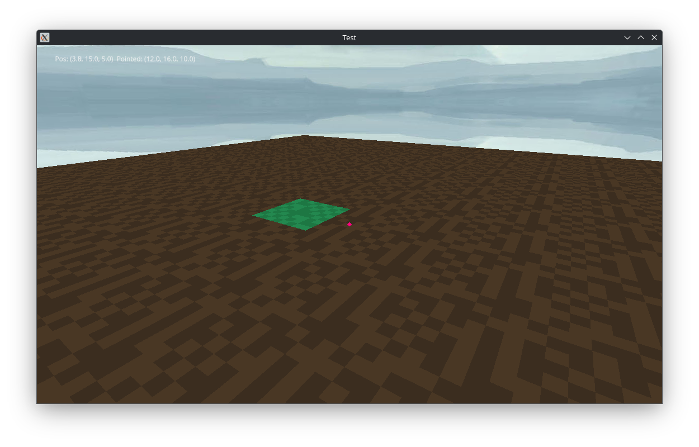

# blockdemo-notfinished
**THIS IS NOT FINISHED AND IS BARELY A DEMO. PLEASE DO NOT COMPLAIN ABOUT LACK OF FEATURES. YOU MAY ASK FOR NEW FEATURES IF YOU WISH.**
This is a simple demo of a voxel-based game, using the Ursina Engine [https://www.ursinaengine.org/](https://www.ursinaengine.org/) and numpy [https://numpy.org/](https://numpy.org/).

You will need the following dependencies (you will also likely have to create a venv, use `python3-venv` for that.
|Dependency|URL|
|---|---|
|python3|[https://www.python.org/](https://www.python.org/)|
|ursina|[https://www.ursinaengine.org/](https://www.ursinaengine.org/)|
|numpy|[https://numpy.org/](https://numpy.org/)|
|Optional: python3-tkinter|[https://www.python.org/](https://www.python.org/)|

## Controls
Use W,A,S,D as arrow keys (W=up, S=down, so on). To jump, press Space. To toggle the mouse being captured, press Escape. To respawn, press "r" or go below y=0.
The mouse will be captured by default.

## Screenshot

